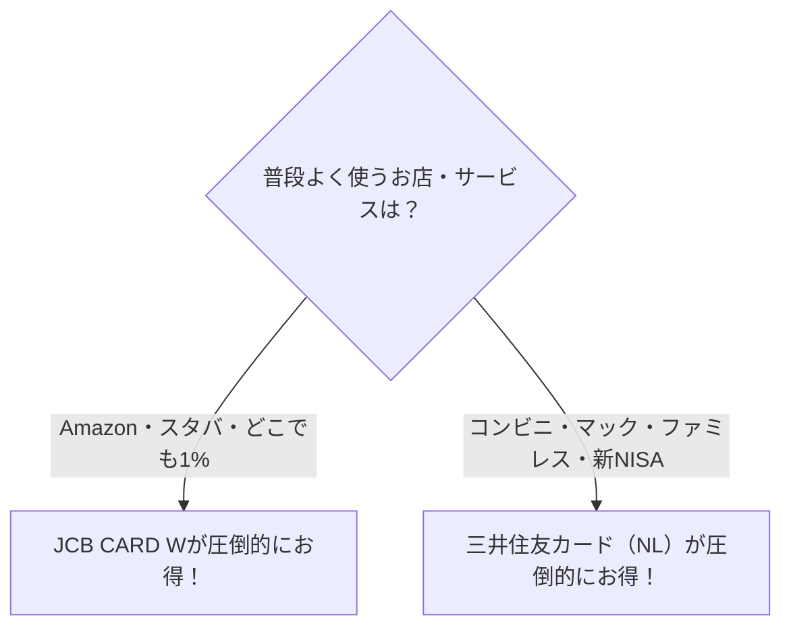

【PR】本記事にはアフィリエイト広告が含まれています。

「年会費無料でポイントが一番貯まるカードを作りたい！」
「JCB CARD Wと三井住友カード（NL）、どっちが自分に向いているの？」
「Amazonやスタバをよく使うならJCB？それともコンビニ最強の三井住友？」

初めて本格的な高還元クレジットカードを作ろうとするとき、必ず候補に挙がるのが**「JCB CARD W」**と**「三井住友カード（NL）」**の2枚です。

どちらも**年会費が完全無料**でスペックが極めて高いため、「結局どっちを選べばいいの？」と迷う人が後を絶ちません。

結論から言うと、**「あなたが普段どこでお金を使っているか」によって選ぶべきカードは完全に分かれます。**

本記事では、2大人気カードのスペック比較表、店舗別還元率対決、メリット・デメリット、そして迷ったときの結論までを分かりやすく解説します。

---

## 1. スペック比較早見表

まずは、両カードの基本スペックを一目で比較してみましょう。

| 項目 | JCB CARD W | 三井住友カード（NL） |
| :--- | :---: | :---: |
| **年会費** | **永年無料** | **永年無料** |
| **入会条件** | **18歳〜39歳限定**（※発行後は40歳以降も無料継続） | 18歳以上（高校生除く） |
| **基本還元率** | **1.0%**（常にポイント2倍） | 0.5% |
| **Amazon利用** | **2.0%還元**（パートナー店登録） | 0.5% |
| **スターバックス** | **最大5.5%〜10.5%還元**（eGift/チャージ） | 0.5% |
| **セブン・ローソン・マクドナルド等** | 1.0%〜2.0% | **最大7.0%還元**（スマホタッチ決済） |
| **国際ブランド** | JCB（日本発の国際ブランド） | Visa / Mastercard |
| **ポイントの名称** | Oki Dokiポイント | Vポイント |
| **SBI証券 新NISA積立** | ❌（積立不可） | ⭕️ **0.5%還元** |

---

## 2. 【店舗別】還元率ガチンコ直接対決！

どちらのカードが得になるかは、日常の決済シーンによって勝敗が明確に分かれます。

### 対決①：Amazonでの買い物 ➜ **【JCB CARD Wの圧勝！】**
* **JCB CARD W**: **2.0%還元**（JCBオリジナルシリーズパートナー店特典）
* **三井住友カード（NL）**: 0.5%還元

ネットショッピングでAmazonを月に1回以上使うなら、JCB CARD Wが圧倒的に優勢です。貯まったポイントを直接Amazonの支払いに1pt=3.5円相当として充当することも可能です。

### 対決②：スターバックス ➜ **【JCB CARD Wの圧勝！】**
* **JCB CARD W**: **最大5.5%〜10.5%還元**（スターバックス カードへのオンラインチャージやStarbucks eGift購入時）
* **三井住友カード（NL）**: 0.5%還元

スタバをよく利用するカフェ好き、ノマドワーカーにとって、JCB CARD Wの還元率は他のカードの追随を許さないレベルです。

### 対決③：セブン-イレブン・ローソン・外食 ➜ **【三井住友カード（NL）の圧勝！】**
* **三井住友カード（NL）**: **最大7.0%還元**（スマホのVisaのタッチ決済/Mastercardタッチ決済時）
* **JCB CARD W**: セブン-イレブンで2.0%、ローソンで1.0%

ランチのコンビニ通いや、マクドナルド、ガスト、サイゼリヤ、すき家、はま寿司など、対象の飲食店を日常的に使う方なら、三井住友カード（NL）の7%還元は爆発的にポイントが貯まります。

### 対決④：スーパー、ドラッグストア、公共料金 ➜ **【JCB CARD Wの勝ち】**
* **JCB CARD W**: **常時1.0%還元**
* **三井住友カード（NL）**: 0.5%還元

特約店以外での普段使い（街のスーパー、薬局、水道光熱費、サブスク代など）では、三井住友カード（NL）の2倍の還元率を誇るJCB CARD Wに軍配が上がります。

---

## 3. あなたはどっち？タイプ別・おすすめ診断

### 💡 こんな人は「JCB CARD W」がおすすめ！
* **39歳以下**である（40歳以上は新規申し込み不可のため今がチャンス）
* **Amazon**で日用品や本、ガジェットを頻繁に購入する
* **スターバックス**によく行く
* どこで使っても安定して**1.0%以上の高還元**を受けたい
* 初めてのクレジットカードで、メインカードとして1枚だけ持ちたい

### 💡 こんな人は「三井住友カード（NL）」がおすすめ！
* **セブン-イレブン、ローソン、マクドナルド、サイゼリヤ等**によく行く
* **SBI証券で新NISAのクレカ積立**をやりたい
* カード番号が券面に印字されていない**完全ナンバーレス**で安心安全に使いたい
* 海外旅行で使いやすいVisaやMastercardを持ちたい
* **40歳以上**である

---

## 4. 迷ったときの最強の結論：実は「2枚持ち」が最も賢い！

「Amazonも使うし、コンビニも使う…どうしても決められない！」という方。

実は、賢いポイ活上級者の多くは**「JCB CARD Wと三井住友カード（NL）の両方を2枚持ち」**しています。

どちらも**年会費は永久に1円もかからない**ため、2枚持っても維持コストは完全ゼロ。

* **街の普段使い・Amazon・スタバ**: JCB CARD W（1.0%〜10.5%）で払う
* **コンビニ・ファミレス・新NISA積立**: 三井住友カード（NL）（最大7.0%）で払う

この「使い分け」を実践するだけで、生活費全体の還元率を**2%〜3%台まで極限まで引き上げる**ことができます。

まずはあなたの生活に最もフィットする1枚から発行してみてください！

  

    
Amazon・スタバ派なら絶対これ！

    

      

        <h4 class="affiliate-title">JCB CARD W（18歳〜39歳限定）</h4>
        
年会費永年無料！いつでもポイント2倍（1.0%還元）。Amazonで2.0%、スタバで最大10.5%の超高還元を誇る、30代以下必携の最強メインカード。

        <ul class="affiliate-points">
          <li><strong>年会費</strong>：永年無料（※39歳までに申し込めば40歳以降も無料継続）</li>
          <li><strong>還元率</strong>：通常1.0%（Amazon 2.0% / スタバ最大10.5%）</li>
          <li><strong>ナンバーレス</strong>：最短5分で即時発行・スマホ決済対応</li>
        </ul>
        

          <a href="https://www.jcb.co.jp/" target="_blank" rel="noopener noreferrer nofollow" class="btn btn-primary btn-large">JCB CARD W 公式サイトへ</a>
        

      

    

  

  

    
コンビニ・外食・新NISAならこれ！

    

      

        <h4 class="affiliate-title">三井住友カード（NL）</h4>
        
年会費永年無料。対象のコンビニ・飲食店でスマホのタッチ決済を使うと最大7.0%還元！SBI証券の新NISAクレカ積立でも大人気の鉄板カード。

        <ul class="affiliate-points">
          <li><strong>年会費</strong>：永年無料（全年齢対象）</li>
          <li><strong>還元率</strong>：通常0.5%（対象コンビニ・飲食店で最大7.0%）</li>
          <li><strong>セキュリティ</strong>：完全ナンバーレスで安心・最短10秒で即時発行</li>
        </ul>
        

          <a href="https://www.smbc-card.com/" target="_blank" rel="noopener noreferrer nofollow" class="btn btn-primary btn-large">三井住友カード（NL）公式サイトへ</a>
        

      

    

  

