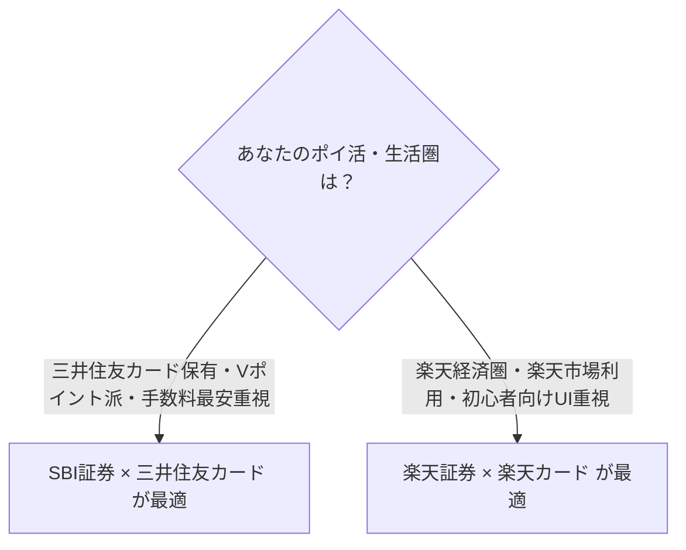

「新NISAでクレカ積立を始めたいけれど、どこが一番ポイントが貯まるの？」
「SBI証券と楽天証券、クレカ積立の還元ルールが変更されてどれが正解かわからない…」
「毎月10万円積み立てると、年間でどれくらいポイントに差がつくの？」

新NISAのスタートに伴い、クレジットカードによる投資信託の積立上限額が**「月5万円から月10万円」**へと拡大されました。

毎月10万円（年間120万円）を積み立てる場合、還元率が0.5%違うだけで**年間6,000円、10年で6万円以上**ものポイント差が生まれます。

しかし、各社でポイント付与条件の変更（改悪）が相次ぎ、「どのカードでどこに積み立てるべきか」の勢力図は大きく塗り替えられました。

本記事では、**主要4大ネット証券の最新クレカ積立還元率、年間付与ポイントの比較、そして各証券会社の強み**を比較します。

---

## 1. 主要ネット証券×クレカ積立の比較早見表

主要4社の「証券会社 × クレジットカード」の還元率と年会費を整理しました。

| 証券会社 | 対象カード | 年会費 | 積立還元率 | 毎月10万積立時の年間ポイント |
| :--- | :--- | :---: | :---: | :---: |
| **SBI証券** | 三井住友カード（NL） | **永年無料** | 0.5% | 6,000pt |
| **SBI証券** | 三井住友カード ゴールド（NL） | 5,500円（※年100万利用で永年無料） | **1.0%**（※年10万以上の本会員決済時） | **12,000pt** |
| **SBI証券** | プラチナプリファード | 33,000円 | **最大3.0%**（※年間決済額に応じて変動） | **最大36,000pt** |
| **楽天証券** | 楽天カード（通常） | **永年無料** | **0.5%**（代行手数料0.4%未満ファンド） | 6,000pt |
| **楽天証券** | 楽天ゴールドカード | 2,200円 | 0.75% | 9,000pt |
| **楽天証券** | 楽天プレミアムカード | 11,000円 | **1.0%** | 12,000pt |
| **マネックス証券** | マネックスカード | 実質無料（年1回利用） | **最大1.1%** | 約8,760pt（※上限配分あり） |
| **auカブコム証券** | au PAY カード | 永年無料（auユーザー以外も） | **1.0%** | 12,000pt |

---

## 2. SBI証券 vs 楽天証券：どちらを選ぶべき？

多くの投資家が悩むのが、口座開設数トップ2の**「SBI証券」**と**「楽天証券」**の対決です。

### SBI証券 × 三井住友カードの特徴
* **強み**: 
  - 取扱銘柄数、投信保有ポイント（マイレージ）、夜間取引など総合力で国内No.1。
  - **ゴールド（NL）**で年100万円修行を達成すれば、年会費無料のまま**年12,000Vポイント（還元率1.0%）**を継続獲得できる。
* **注意点**: 
  - クレカ積立のポイント付与には「カードショッピング利用額（年間10万円以上など）」の条件があるため、完全放置ではなく日常決済でも少し使う必要があります。

### 楽天証券 × 楽天カードの特徴
* **強み**: 
  - 楽天市場や楽天Payなど**「楽天ポイント」**を普段から使っている人には使い勝手が良い。
  - 管理画面やスマホアプリ（iSPEED）の操作性が初心者向けに非常に分かりやすい。
  - 楽天キャッシュ決済（月5万円）とクレカ積立（月10万円）を併用すると**月最大15万円**までキャッシュレス積立可能。
* **注意点**: 
  - 一般楽天カードの場合、低コストインデックス投信（オルカン、S&P500等）の還元率は**0.5%**にとどまります。

---

## 3. 年間獲得ポイントシミュレーション（月10万円積立時）

毎月10万円（年間120万円）を愚直に積み立てた場合、5年間・10年間でどれだけのポイント差になるかを計算しました。

| クレカ積立パターン | 還元率 | 1年間のポイント | 5年間の累計 | 10年間の累計 |
| :--- | :---: | :---: | :---: | :---: |
| **三井住友 ゴールド（NL）** | **1.0%** | **12,000 pt** | **60,000 pt** | **120,000 pt** |
| **マネックスカード** | **約0.73%〜1.1%** | 約8,760 pt | 約43,800 pt | 約87,600 pt |
| **一般カード（三井住友NL / 楽天）** | **0.5%** | 6,000 pt | 30,000 pt | 60,000 pt |

10年間でなんと**6万円〜12万円分**の差がつきます。このポイントをさらに投資信託のスポット買付に再投資（ポイント投資）すれば、複利効果で資産形成のスピードはさらに加速します。

---

> **あわせて読みたい**
> - [三井住友カード（NL）・ゴールド・プラチナプリファードの比較](/posts/smbc-card-nl-vs-gold-vs-platinum-preferred/)
> - [三井住友カード ゴールド（NL）100万円修行のやり方](/posts/smbc-gold-100man-shugyo-guide/)
> - [子ども名義のNISAと大学資金づくり](/posts/junior-nisa-kids-investment-guide/)

## 4. 結論：新NISAクレカ積立の最適解

* **迷ったら総合力No.1**: **SBI証券 ＋ 三井住友カード ゴールド（NL）**
  - 100万円修行をクリアして年会費永年無料にすれば、毎月10万円積立で年間12,000ポイントをノーコストで回収できます。
* **楽天経済圏にどっぷり**: **楽天証券 ＋ 楽天カード**
  - 普段から楽天市場での買い物が多く、ポイントを楽天ペイで街中で消化したいならこれ一択。
* **年会費完全無料で1.0%狙い**: **auカブコム証券 ＋ au PAY カード** または **マネックス証券**

口座開設もカード発行もすべてオンラインで完結します。新NISAの積立とあわせて、カードのポイントも受け取れます。

{{cta:card-smbc-gold}}

{{cta:card-003}}

