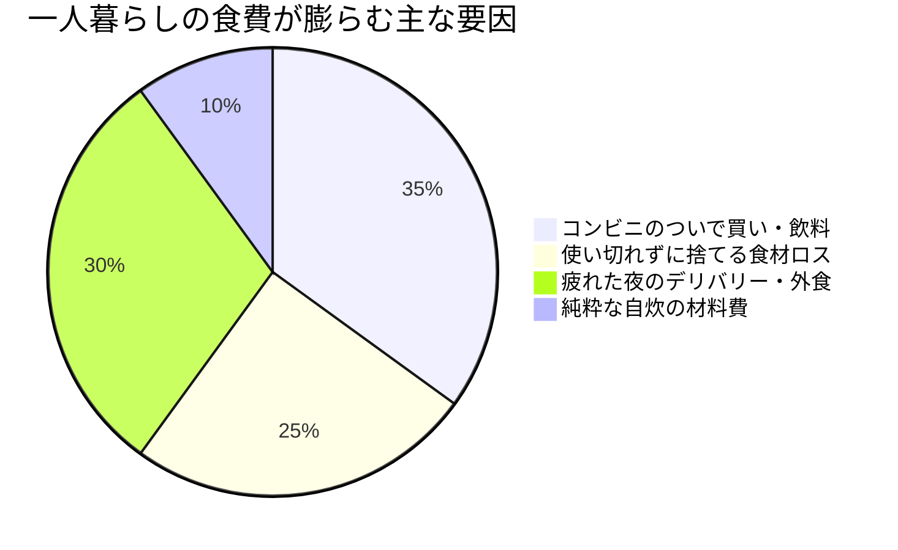
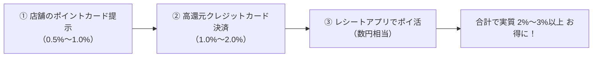

【PR】本記事にはアフィリエイト広告が含まれています。

「物価高で毎月の食費が4万〜5万円を超えてしまう…」
「自炊を頑張ろうと食材を買っても、結局腐らせて捨ててしまう」
「一人暮らしで無理なく食費を『月2万円』に抑える現実的な方法を知りたい！」

野菜、卵、お肉、加工食品まであらゆる食品の値上げが続く2026年現在。  
一人暮らしの平均食費は約40,000円〜45,000円と言われており、油断しているとあっという間に家計を圧迫します。

しかし、**「正しい買い出しルール」「ズボラでも続く冷凍術」「キャッシュレス決済のポイント多重取り」**の3つを組み合わせれば、ストレスなく**月2万円（1日約650円）**に抑えることは十分に可能です。

本記事では、我慢やもやし生活に頼らず、健康と満足感をキープしながら食費を劇的に下げるステップを分かりやすく解説します。

---

## 1. なぜ食費が跳ね上がるのか？原因ワースト3

食費が4万円を超える人の共通点は、「贅沢をしているから」ではなく**「日々の小さな無意識の出費」**にあります。

1. **コンビニの「ついで買い」**:  
   おにぎりや飲み物を買うついでにスイーツやホットスナックを買い、1回あたり700円〜1,000円使ってしまう（月1.5万〜2万円の損失）。
2. **冷蔵庫の食材ロス**:  
   キャベツ一玉、大根、バラ肉などを使い切れずに賞味期限切れで廃棄してしまう。
3. **疲労時のデリバリー・外食**:  
   自炊のハードルを上げすぎて疲れてしまい、Uber Eats等で1食1,500円〜2,000円を使ってしまう。

まずはこの3大原因をブロックする仕組みを作ることが最優先です。

---

## 2. 月2万円を達成する「週別予算」の組み立て方

食費をコントロールする最大の秘訣は、月単位ではなく**「週単位」**で管理することです。

* **1ヶ月の予算**: 20,000円
* **内訳**:
  - 第1週：4,500円
  - 第2週：4,500円
  - 第3週：4,500円
  - 第4週：4,500円
  - **予備費（外食・調味料補充）**: 2,000円

「今週は4,500円しか使えない」と決めるだけで、スーパーのカゴに入れる食材を自然と厳選できるようになります。

---

## 3. コスパの高い「おすすめ食材」リストと冷凍術

一人暮らしの自炊で買うべきは、**「安い」「栄養がある」「日持ち（冷凍）する」**の3拍子が揃った食材です。

| 食材ジャンル | おすすめのおすすめ食材 | 節約テクニック |
| :--- | :--- | :--- |
| **お肉類** | 鶏むね肉（100g 60〜80円）、豚こま肉、鶏ひき肉 | 買ったらすぐ1食分ずつラップに小分けして冷凍 |
| **野菜類** | もやし、きのこ類（えのき・しめじ）、玉ねぎ、冷凍ブロッコリー | きのこは冷凍すると旨味成分がアップ！ |
| **大豆製品・卵** | 納豆、豆腐、卵 | 完全栄養食の卵は毎日1〜2個。納豆は手軽な副菜 |
| **主食** | お米（5kgまたは10kgまとめ買い）、パスタ、うどん（冷凍） | お米は一度に3〜4合炊いて即ラップ冷凍 |

**💡 ワンポイントアドバイス**:  
自炊は「毎食きちんと料理する」必要はありません。**「ご飯をレンジでチン＋納豆＋卵＋お味噌汁＋冷凍鶏肉を焼くだけ」**で、立派な高タンパク・低コスト定食（1食約150円）が完成します。

---

## 4. 現金払いは大損！決済ポイントの「三重取り」技

食材の買い出しで現金払いをしていると、年間で数万円単位のポイントをドブに捨てることになります。

スーパーやドラッグストアでは、以下の方法で**ポイントを多重取り**しましょう。

* **楽天カード**: 楽天市場でのお米や調味料のまとめ買いでポイントがザクザク貯まり、街中のスーパーでも常時1.0%還元。
* **三井住友カード（NL）**: 対象コンビニ（セブン、ローソン等）やファミレスでの急な利用時もスマホタッチで最大7.0%還元。
* **Amazon定期おトク便**: パスタや缶詰、お水、日用品はAmazonの定期便でまとめ買いすると最大10〜15%オフになり、重い荷物を運ぶ手間も省けます。

---

## 5. まとめ：賢く食べて、無理なく資産を守ろう

食費の節約は「我慢の連続」ではなく、**「買い出しのルール化」と「決済の最適化」**です。

1. 週4,500円の予算を死守する
2. 鶏むね肉・卵・きのこ・冷凍ご飯を常備する
3. 支払いは高還元クレジットカード（楽天カード等）に集約する

浮いた月2万円を新NISAの積立投資に回せば、10年後には数百万円の大きな資産に化けます。今日からのスーパーの買い出しから、ぜひ実践してみてください！

  

    
食費・日用品の節約なら鉄板の1枚！

    

      

        <h4 class="affiliate-title">楽天カード</h4>
        
年会費永年無料！スーパーやドラッグストアの買い物でも常時1.0%還元。楽天市場でのお米・飲料・調味料のまとめ買いで最大ポイント還元が受けられる節約生活の必需品。

        <ul class="affiliate-points">
          <li><strong>年会費</strong>：永年無料</li>
          <li><strong>還元率</strong>：通常1.0% / 楽天市場で3.0%以上</li>
          <li><strong>ポイント使い道</strong>：楽天ペイでスーパーやコンビニの支払いに1pt=1円で利用可能</li>
        </ul>
        

          <a href="https://www.rakuten-card.co.jp/" target="_blank" rel="noopener noreferrer nofollow" class="btn btn-primary btn-large">楽天カード 公式サイトへ</a>
        

      

    

  

  

    
お米・飲料・調味料のまとめ買いでお得！

    

      

        <h4 class="affiliate-title">Amazonプライム（30日間無料体験）</h4>
        
お米やミネラルウォーターなどの重い食品を送料無料で玄関先までお届け。定期おトク便で最大10〜15%オフ。プライムビデオで映画やアニメも見放題。

        <ul class="affiliate-points">
          <li><strong>お急ぎ便・日時指定便</strong>：何度使っても完全無料</li>
          <li><strong>定期おトク便</strong>：食品・日用品が自動で最大15%割引</li>
          <li><strong>無料体験</strong>：30日間無料でいつでもキャンセル可能</li>
        </ul>
        

          <a href="https://www.amazon.co.jp/" target="_blank" rel="noopener noreferrer nofollow" class="btn btn-primary btn-large">Amazonプライム 無料体験はこちら</a>
        

      

    

  

