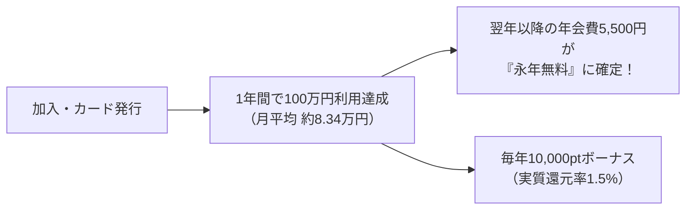

【PR】本記事にはアフィリエイト広告が含まれています。

「三井住友カード ゴールド（NL）を作りたいけれど、年間100万円も使えるか不安…」
「100万円修行で、何が対象になって何が対象外なのかがややこしい！」
「あと20万円足りない！無駄遣いせずに一気に枠を埋める方法はないの？」

ナンバーレスカードの中でもトップクラスの人気を誇る**「三井住友カード ゴールド（NL）」**。  
その最大の目玉特典が、一度でも年間100万円利用を達成すると、**「翌年以降の年会費5,500円（税込）が永年無料」**になり、さらに**「毎年10,000Vポイントがもらえる」**という神スペックです。

この年間100万円の利用条件をクリアすることは、通称**「100万円修行」**と呼ばれています。

しかし、ルールを正しく理解していないと、**「100万円使ったつもりが対象外の決済ばかりで未達成だった…」**という最悪の事態になりかねません。

本記事では、100万円修行のカウント対象・対象外リストを網羅し、**無駄な買い物を1円もせずに確実に100万円を達成する王道＆方法ルート**を徹底解説します。

---

## 1. 100万円修行の基本ルールと豪華リターン

まずは、修行を始める前に押さえておくべき基本ルールとリターンを確認しましょう。

* **達成リターン①**: 翌年以降、**年会費が一生涯無料**（※一度達成すれば翌年以降は年100万使わなくてもずっと無料）
* **達成リターン②**: 100万円達成年に**10,000ポイント（1万円相当）**付与（通常還元率0.5%と合わせて実質**1.5%還元**）
* **集計期間**: カード加入月の翌月1日〜11ヶ月後の末日（計11ヶ月〜12ヶ月間）  
  *(例：11月15日入会の場合、翌年11月30日までの決済が対象)*

月平均に換算すると**「月額 約83,400円」**の利用が必要です。家賃や光熱費、日常の支払いを集約すれば、一人暮らしでも十分に射程圏内に入ります。

---

## 2. 【要注意】100万円修行の「対象」と「対象外」完全リスト

最も重要なのが決済の仕分けです。「これ対象外だったの！？」と後悔しないよう、必ず事前にチェックしてください。

### ❌ カウント対象外となる取引（修行に使えないもの）

| 項目 | 判定 | 注意点・理由 |
| :--- | :---: | :--- |
| **SBI証券のクレカ積立** | ❌ **対象外** | ポイントは貯まるが、100万円修行の判定金額には**1円も加算されません** |
| **年会費** | ❌ **対象外** | カード初年度年会費5,500円や家族カード年会費 |
| **交通系ICへのチャージ** | ❌ **対象外** | Mobile Suica、Mobile PASMO、ICOCAへのチャージ |
| **電子マネーチャージ** | ❌ **対象外** | nanaco、WAON、Edy等へのチャージ |
| **キャッシング・リボ手数料** | ❌ **対象外** | キャッシング利用分、リボ払い・分割払いの手数料 |
| **三井住友カード発行のプリカ** | ❌ **対象外** | Vポイント残高へのチャージ等 |

特に勘違いしやすいのが**「SBI証券の新NISAクレカ積立」**です。毎月10万円積み立てても、修行の100万円には一切カウントされないため注意してください。

### ⭕️ カウント対象となる取引（修行に使えるもの）

| 項目 | 判定 | おすすめポイント |
| :--- | :---: | :--- |
| **Amazonギフト券のチャージ** | ⭕️ **対象** | **修行でよく使われる方法！有効期限10年で先買い可能** |
| **Kyash / Revolutへのチャージ** | ⭕️ **対象** | ポイントを二重取りしながらプリペイドに退避 |
| **公共料金・携帯料金・サブスク** | ⭕️ **対象** | 電気・ガス・水道・スマホ・ネット・Netflix等 |
| **税金・ふるさと納税** | ⭕️ **対象** | 自動車税・固定資産税・地方税お支払いサイト・ふるさと納税 |
| **スーパー・コンビニ・外食** | ⭕️ **対象** | スマホのタッチ決済で最大7%還元も同時適用 |
| **家電・旅行・ホテル代** | ⭕️ **対象** | 高額な出費のタイミングを一気に集約 |

---

## 3. 無駄遣いゼロで達成する「おすすめ修行ルート」4選

「あと20万円足りない…」「毎月の生活費だけでは届きそうにない」という場合でも、以下の4つのルートを使えば無理なく安全に枠を埋めることができます。

### ルート①：Amazonギフト券チャージ（駆け込み向けの方法）
期限が迫っているときの最も確実な救済策が**「Amazonギフト券へのチャージ」**です。

* **メリット**: 有効期限が**10年間**あるため、日用品や飲料、ガジェットなど将来必ず買うものを先買いできる。
* **やり方**: 期限前月に足りない金額（例: 10万円〜20万円分）を自分のAmazonアカウントにギフト券チャージするだけ。

### ルート②：KyashやIDareなどのプリペイドカードへチャージ
日常の支払いを後からゆっくり使いたい場合は、プリペイドカードへのチャージが有効です。

* **Kyash**: 月間のチャージ枠を活用し、日常の少額決済用資金としてプール。
* **IDare（イデア）**: 年利相当のボーナスが付く積立プリペイドにチャージし、後日の決済に回す。

### ルート③：ふるさと納税＆税金のまとめ払い
毎年支払う住民税、自動車税、固定資産税やふるさと納税を、三井住友カード ゴールド（NL）で決済します。

* **ふるさと納税**: 「楽天ふるさと納税」や「ふるさとチョイス」などを利用すれば、返礼品をもらいながら数万円〜十数万円を一気に修行枠に算入できます。
* **国税・地方税**: 「地方税お支払いサイト（eL-QR）」を利用すれば、クレジットカード納付が可能です（※所定の決済手数料がかかります）。

### ルート④：家族の固定費や立替払いを集約する
* 家賃（クレジットカード決済対応物件の場合）
* 家族カードの発行（家族カードの利用分も本会員の100万円修行に合算カウントされます！）
* 飲み会や旅行の幹事になって一括立替払い

---

## 4. 修行の達成度・残り金額を1秒で確認する方法

三井住友カードの公式スマホアプリ**「Vpassアプリ」**には、100万円修行専用の達成状況メーターが用意されています。

1. Vpassアプリにログイン
2. カード選択で「ゴールド（NL）」を選択
3. ホーム画面の「あなたの100万円達成状況」プログレスバーをタップ
4. **「対象期間」「現在の累計達成額」「あといくら必要か」**がリアルタイムに表示されます。

対象外決済（Suicaチャージ等）は自動的に除外されて計算されるため、このアプリのメーターだけを見ていれば失敗することはありません。

---

> **あわせて読みたい**
> - [三井住友カード（NL）・ゴールド・プラチナプリファードの比較](/posts/smbc-card-nl-vs-gold-vs-platinum-preferred/)
> - [新NISAクレカ積立の比較（SBI・楽天・マネックス）](/posts/nisa-creca-tsumitate-comparison-2026/)
> - [ポイント還元率の計算方法](/posts/credit-card-point-rate-calculation/)

## 5. まとめ：ゴールド（NL）は修行してでも持つ価値がある！

三井住友カード ゴールド（NL）は、一度100万円修行を達成してしまえば、**一生涯年会費無料で保有できる最強のステータスカード**です。

* コンビニ・飲食店でのスマホタッチ決済で**最大7.0%還元**
* 年間100万円利用で毎年**10,000ptプレゼント（実質還元率1.5%）**
* 国内主要空港のカードラウンジが無料
* 最大2,000万円の旅行傷害保険付帯

これから申し込む方は、引っ越しや家具家電の買い替え、旅行など**「大きな出費が控えているタイミング」**で入会すると、驚くほどあっさりと100万円をクリアできます。

今すぐゴールド（NL）を手に入れて、年会費永年無料のゴールドホルダーを目指しましょう！

  

    
100万円修行で年会費が一生無料！

    

      

        <h4 class="affiliate-title">三井住友カード ゴールド（NL）</h4>
        
年100万円の利用で翌年以降の年会費5,500円が永年無料！さらに毎年10,000pt還元。空港ラウンジ無料＆対象コンビニ・外食で最大7%還元のハイパフォーマー。

        <ul class="affiliate-points">
          <li><strong>年会費</strong>：5,500円（年間100万円利用で翌年以降<strong>永年無料</strong>）</li>
          <li><strong>還元率</strong>：通常0.5% ＋ 特約店最大7.0% ＋ 年間利用ボーナス10,000pt</li>
          <li><strong>特典</strong>：国内主要空港ラウンジ無料 / SBI証券クレカ積立で高還元</li>
        </ul>
        

          <a href="https://www.smbc-card.com/" target="_blank" rel="noopener noreferrer nofollow" class="btn btn-primary btn-large">三井住友カード ゴールド（NL）公式サイトへ</a>
        

      

    

  

